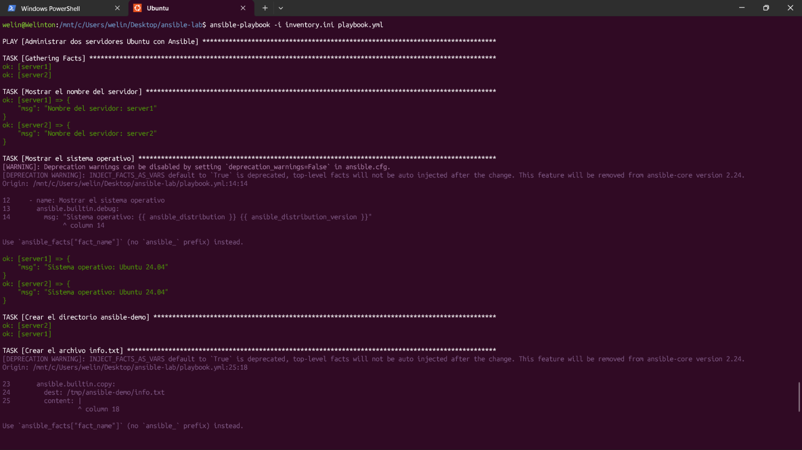
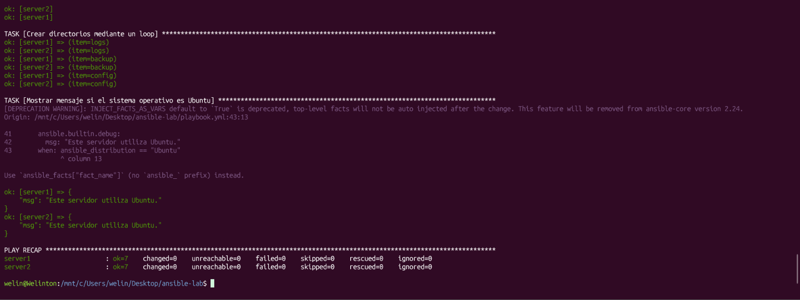

# Laboratorio Ansible con Docker

## Objetivo de la práctica

Crear un laboratorio compuesto por dos servidores Linux utilizando contenedores Docker y administrarlos mediante Ansible. Se busca practicar la ejecución de tareas automatizadas, el uso de variables, condiciones y ciclos (loops).

## Tecnologías utilizadas

- Docker.
- Docker Compose.
- Ubuntu 24.04.
- Ansible.
- Python 3.

## Estructura del proyecto

```text
ansible-lab/
├── docker-compose.yml
├── inventory.ini
├── playbook.yml
├── README.md
└── capturas/
    └── ejecucion-playbook.png
```

## Iniciar los servidores

Para crear e iniciar los dos contenedores Ubuntu, ejecutar:

```bash
docker compose up -d
```

Para comprobar que ambos servidores están funcionando:

```bash
docker ps
```

## Preparar los servidores

Instalar Python 3 en ambos contenedores:

```bash
docker exec server1 apt update
docker exec server1 apt install -y python3

docker exec server2 apt update
docker exec server2 apt install -y python3
```

## Comprobar la conexión con Ansible

```bash
ansible docker -i inventory.ini -m ping
```

## Ejecutar el Playbook

Para ejecutar todas las tareas automatizadas:

```bash
ansible-playbook -i inventory.ini playbook.yml
```

## Tareas realizadas

El playbook realiza las siguientes operaciones en los dos servidores:

1. Mostrar el nombre del servidor.
2. Mostrar el sistema operativo.
3. Crear el directorio `/tmp/ansible-demo`.
4. Crear el archivo `info.txt` con el nombre del servidor y su sistema operativo.
5. Crear los directorios `logs`, `backup` y `config` mediante un loop.
6. Mostrar un mensaje cuando el sistema operativo sea Ubuntu.

## Evidencia de ejecución

A continuación se presenta la captura de pantalla de la ejecución exitosa del playbook:




## Resultado

Los dos servidores Ubuntu fueron administrados correctamente mediante Ansible. Las tareas se ejecutaron de forma automatizada y se comprobó la creación de los archivos y directorios solicitados.
